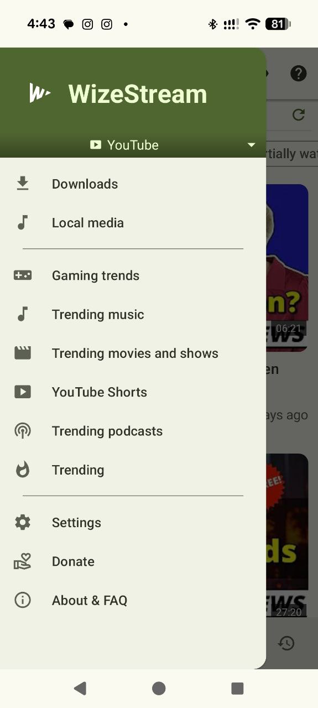
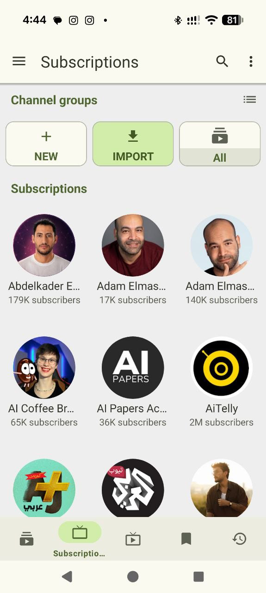
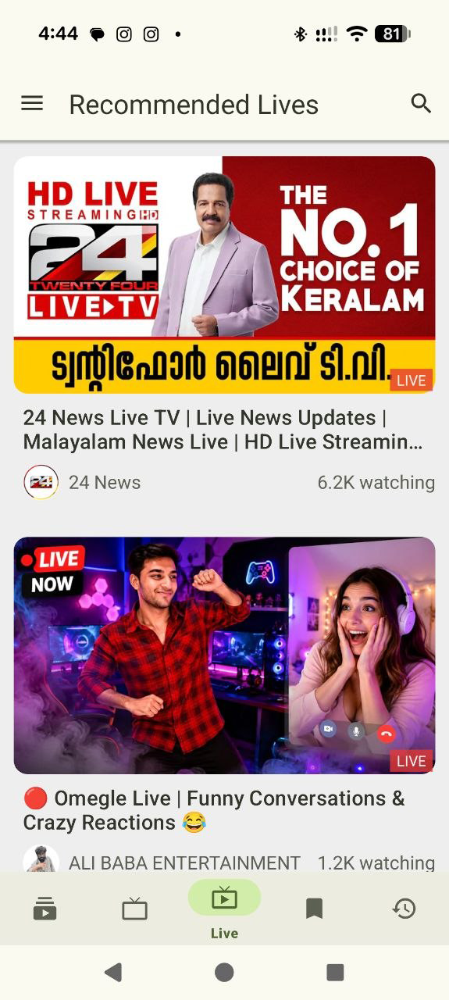
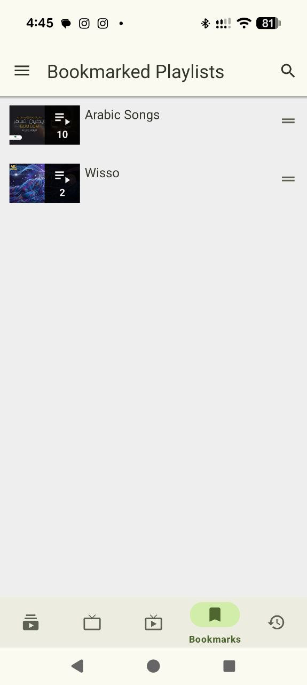

<p align="center"><a href="https://github.com/wizdom13/WizeStream"></a></p>

<h1 align="center">WizeStream</h1>

<p align="center"><b>An independent, privacy-friendly NewPipe-based streaming client for Android.</b></p>

<p align="center">
  <a href="https://apt.izzysoft.de/packages/org.wisso.newpipematerial"></a>
  <a href="https://github.com/wizdom13/WizeStream/releases"></a>
  <br>
  <a href="https://github-store.org/app?repo=wizdom13/WizeStream"></a>
</p>

<p align="center">
  <a href="https://www.gnu.org/licenses/gpl-3.0"></a>
  <a href="https://github.com/wizdom13/WizeStream/actions"></a>
  <a href="https://apt.izzysoft.de/packages/org.wisso.newpipematerial"></a>
  <a href="https://shields.rbtlog.dev/org.wisso.newpipematerial"></a>
</p>

<hr>

<p align="center">
  <a href="#important-project-notice">Project notice</a> •
  <a href="#what-is-wizestream">About</a> •
  <a href="#screenshots">Screenshots</a> •
  <a href="#supported-services">Services</a> •
  <a href="#features">Features</a> •
  <a href="#android-auto">Android Auto</a> •
  <a href="#device-synchronization">Device sync</a> •
  <a href="#installation">Installation</a> •
  <a href="#building-from-source">Build</a> •
  <a href="#release-signing">Signing</a> •
  <a href="#development-status">Development</a> •
  <a href="#contributing">Contributing</a> •
  <a href="#upstream-newpipe">Upstream</a> •
  <a href="#star-history">Star History</a> •
  <a href="#license">License</a>
</p>

<p align="center">Translations are welcome, but only native-speaker reviewed translations will be added.</p>

---

## Important project notice

WizeStream is an independent, NewPipe-based streaming client for Android. It combines a modern
Material 3 Expressive interface with privacy-friendly playback, useful local-first features, and
support for multiple streaming platforms.

WizeStream maintains its own application and integrated extractor changes. It is **not affiliated
with, sponsored by, or endorsed by** the official NewPipe project, TeamNewPipe, or NewPipe e.V.

WizeStream preserves the NewPipe libre software license, upstream credits, and third-party license notices.

- [Frequently asked questions](docs/faq.md)
- [Privacy policy](PRIVACY.md)

### Rebranding from NewPipe Material

WizeStream was previously called **NewPipe Material**. The new name distinguishes this
independently maintained app from official NewPipe. See [issue #34](https://github.com/wizdom13/WizeStream/issues/34)
for the original rebranding request.

Existing NewPipe Material users can update normally with a release signed by the same key:
the application ID remains unchanged, and the rename does not reset local data or settings.
Upstream attribution, licensing, and third-party notices are preserved.

### Independent versioning

WizeStream has its own release cycle and follows semantic versioning:

- `MAJOR.MINOR.PATCH`, such as `1.0.0`, `1.1.0`, and `1.2.0`
- Git tags use the corresponding `vMAJOR.MINOR.PATCH` form
- WizeStream version numbers do not contain or follow NewPipe version numbers

NewPipe remains an upstream source and is credited as required, but its version is development
metadata rather than part of WizeStream's public version identity. The currently tracked upstream
baseline is recorded in [UPSTREAM.md](UPSTREAM.md).

---

## What is WizeStream?

WizeStream keeps the lightweight, privacy-friendly NewPipe experience while developing its own
interface, playback, discovery, synchronization, and service-support features. Material 3
Expressive design remains an important project goal, but it is one part of a broader independent
client rather than the project's only purpose.

Project highlights:

- Material 3-inspired design with Material You colors, manual color presets, and customizable navigation
- Account-free playback, subscriptions, feeds, playlists, downloads, and history across supported services
- Local profiles for separate Personal, Work, Study, or other contexts without platform accounts
- Dedicated YouTube Music and YouTube Shorts destinations, advanced search filters, and channel sorting
- Main, background, and popup playback with advanced gestures, a sleep timer, multi-audio selection,
  and per-channel playback profiles
- SponsorBlock, YouTube dislike counts, and clear handling for members-only videos
- Local blocking for videos, channels, and title or uploader keywords, plus contextual search inside
  channel tabs and playlists
- Bulk playlist and queue downloads with embedded media metadata
- Optional DeArrow titles and thumbnails, and open TV casting to FCast and Chromecast-compatible
  receivers on Android 8 and newer
- Optional Learning Mode with timestamped notes, playlist progress, study statistics, and a dashboard
- Secure peer-to-peer synchronization between trusted WizeStream devices, manually or automatically
  over Wi-Fi or Ethernet
- Local search across subscriptions, playlists, feeds, history, and Downloads
- Import/export compatibility with supported NewPipe backup data and a verified in-app update flow

This README describes the current `pipe` branch; recently merged features may arrive in the next
release. See the [release history](docs/changelogs.md) and [published releases](https://github.com/wizdom13/WizeStream/releases)
for version-specific availability.

---

## Screenshots

### Phone

<p align="center">
  <a href="fastlane/metadata/android/en-US/images/phoneScreenshots/01.png"></a>
  <a href="fastlane/metadata/android/en-US/images/phoneScreenshots/02.png"></a>
  <a href="fastlane/metadata/android/en-US/images/phoneScreenshots/03.png"></a>
  <a href="fastlane/metadata/android/en-US/images/phoneScreenshots/04.png"></a>
  <a href="fastlane/metadata/android/en-US/images/phoneScreenshots/05.png"></a>
  <a href="fastlane/metadata/android/en-US/images/phoneScreenshots/06.png"></a>
  <a href="fastlane/metadata/android/en-US/images/phoneScreenshots/07.png"></a>
  <a href="fastlane/metadata/android/en-US/images/phoneScreenshots/08.png"></a>
  <a href="fastlane/metadata/android/en-US/images/phoneScreenshots/09.png"></a>
  <a href="fastlane/metadata/android/en-US/images/phoneScreenshots/10.png"></a>
  <a href="fastlane/metadata/android/en-US/images/phoneScreenshots/11.png"></a>
  <a href="fastlane/metadata/android/en-US/images/phoneScreenshots/12.png"></a>
</p>

### Tablet

<p align="center">
  <a href="fastlane/metadata/android/en-US/images/tenInchScreenshots/09.png"></a>
  <a href="fastlane/metadata/android/en-US/images/tenInchScreenshots/10.png"></a>
</p>

---

## Supported services

WizeStream supports these services through extractor source integrated directly into the app:

- YouTube, including dedicated YouTube Music and YouTube Shorts destinations
- SoundCloud
- media.ccc.de
- PeerTube
- Bandcamp
- Bilibili
- Niconico
- BitChute
- Rumble
- Odysee (experimental)

YouTube playback and downloads use conventional progressive, DASH, and HLS stream URLs exposed by
the bundled extractor source.

### Integrated extractor lineage and responsibility

The bundled extractor is derived from NewPipeExtractor and later incorporated PipePipeExtractor
and WizeStream-specific changes. It is maintained as source inside WizeStream and is therefore
neither the unmodified official NewPipeExtractor nor an external PipePipeExtractor dependency.

Extractor work is part of WizeStream's current scope because service compatibility and playback
fixes can require coordinated application, player, and extractor changes.
Problems encountered in WizeStream—including service and extractor failures—should be reported to
WizeStream first. Comparing a problem with official NewPipe can help determine whether the cause is
shared upstream, but WizeStream remains responsible for defects caused by its bundled changes.

---

## Features

### Profiles and local privacy

- Create separate local profiles and switch quickly from the navigation drawer
- Keep subscriptions, playlists, feed groups, watch history, playback positions, and search history
  separated by profile, including search suggestions and optional search-history synchronization
- Merge or replace profile data with a preview and duplicate handling while preserving the source profile
- Choose a different default profile and delete profiles with confirmation
- Subscribe a channel to another profile or copy a subscription group without switching profiles
- Enable Incognito to pause recording searches, watch history, playback progress, and learning activity
  across profiles and services; it does not make network requests anonymous

### Streaming and discovery

- Watch videos, live streams, and audio without signing in to a platform account
- Browse all [supported services](#supported-services), with dedicated YouTube Music and YouTube
  Shorts destinations
- Search with service-provided content, date, duration, feature, and sorting filters
- Save search-filter presets by profile and service, including YouTube Music mode
- Use custom or relative YouTube upload-date ranges, duration limits, shortest/longest ordering,
  and cancellable deeper or monthly search collection with duplicate removal
- Save searches as reusable feeds with filters, cached results, pagination, and manual refresh
- Search within channel tabs and remote or local playlists without leaving the current screen
- Filter channel, feed, and playlist lists by unwatched, partially watched, live, or Shorts content
- Block individual videos or channels from their context menus, and hide content by title or uploader
  keywords using locally stored rules under **Settings > Content > Blocked content**
- Optionally sync AiSList directly from its upstream project: high-confidence channels are hidden,
  while medium-confidence warnlist channels can be ignored, labeled, warned before playback, or
  hidden; matching stays on-device without sending the viewed video or channel to a detection service
- Allow selected channels through keyword, channel, and AiSList hiding rules; explicitly blocked
  videos remain hidden
- Browse video details, related content, comments, playlists, and channel tabs where supported
- Open a YouTube Music track's album when album metadata is available
- Choose **Top** or **Newest** YouTube comments using the service's ordering, including pagination
- Translate comments on demand with Android's on-device translation service when the required
  language pair is already available locally, with no cloud translation fallback
- Sort channel videos by latest, popular, or oldest, and use podcast tabs on supported channels
- Browse read-only YouTube channel posts with text, images, polls, links, videos, playlists, and
  pagination
- See channel avatars directly in stream lists, open channels from their identity areas, and view
  view or subscriber counts where the service provides them
- Copy stream titles, share streams and playlists, open supported links directly in WizeStream, and
  open a channel's RSS feed where available
- View YouTube dislike counts where available
- Optionally replace YouTube titles and thumbnails with accepted community contributions from DeArrow
- Identify membership-restricted videos with a **Members only** badge, receive a clear explanation
  instead of an unplayable native request, or hide those videos from content lists
- Configure app and content languages, content country, YouTube Restricted Mode, age-restricted
  content visibility, image quality, search suggestions, global search-button behavior, and the
  preferred PeerTube instance

### Playback

- Main, Listen, background, popup, external-player, and Kodi playback
- Switch a video to audio-only Listen mode without losing the queue or playback position, and choose
  from 15 waveform, spectrum, meter, radial, and particle visualizers under **Settings > Video and
  audio > Visualizer style**
- Tune playback with a built-in 10-band equalizer, five presets, a saved custom curve, and automatic
  clipping headroom
- Enable adaptive **Loudness normalization** and **Dynamic range compression** in **Settings > Video
  and audio**; both are off by default and apply to decoded audio in the built-in player
- Browse and resume audio safely through Android Auto, including voice search and a bounded
  **Continue listening** section; video and visualizers are never shown on the driving surface
- Cast compatible streams to discovered FCast and Chromecast-compatible receivers on Android 8 and
  newer, with play, pause, stop, and receiver-switching controls
- Playback queues, repeat and shuffle controls, chapters, captions, and seek-bar thumbnail previews
- Browse chapters in adaptive side or bottom panels while keeping part of the video visible
- Read fullscreen comments and replies beside the video, and enable danmaku bullet comments where supported
- Choose Normal or Full live playback; Full live offers rewind through the history supplied by the stream
- Control autoplay and automatic queue continuation, enqueue items next or last, reorder the play
  queue, and automatically prefer Shorts recommendations while watching Shorts
- Select available video resolutions and formats, including higher adaptive qualities when exposed by
  the service
- Select multi-audio tracks with original, dubbed, descriptive, and secondary labels, with preferences
  for original or descriptive audio
- Set separate default video and popup resolutions, preferred video and audio formats, and a mobile
  data resolution limit
- Set preferred audio and caption languages, with a Show all languages option
- Save playback speed, quality, and caption choices in per-channel playback profiles
- Configure per-channel intro and outro skip durations
- Adjust SDR video brightness, contrast, saturation, and color inversion, with Remember and Reset controls
- Set independent player volume and optionally dim fullscreen playback after inactivity while audio continues
- Retain playback speed for live streams
- Use swipe seeking, fullscreen volume and brightness swipes, hold-to-speed-up, configurable
  pinch-to-zoom and two-finger panning, an optional two-finger playback-speed gesture, and swipe down
  to the miniplayer, including loading and error screens
- Lock fullscreen touch controls from the player's expanded controls; use **Unlock** or leave
  fullscreen to restore touch interaction
- Optionally keep visible video playback in Android's native picture-in-picture window on Android 8
  and newer
- Keep video visible in the minimized player, with optional rounded corners
- Optionally keep the video visible while scrolling its details page
- Configure the preferred action when opening a stream, start or rotate directly into fullscreen even
  when Android orientation is locked, choose the exit/minimize behavior, and remember popup size and
  position
- Set a sleep timer using presets, a custom duration, the end of the current video, or the end of the
  queue, with optional fade-out
- Skip or mark SponsorBlock categories with per-category behavior, colors, notifications, seek-bar
  segments, and a manual skip button
- Save available SponsorBlock segments with newly completed full downloads for offline skipping
  in WizeStream without modifying the media file

### Library, subscriptions, and downloads

- Subscribe to channels without a platform account and organize subscriptions into channel groups
- View subscriptions from all services in the current profile; choose current-platform or all-platform
  views for **What's New** and channel groups, with separate YouTube and YouTube Music membership
- Arrange subscriptions with drag-and-drop ordering, named separators, multiselection, and bulk moves
- Unsubscribe from multiple selected channels with a count confirmation, limited to the current profile
- Refresh feeds manually or in the background, with configurable intervals, optional unmetered networking,
  and refresh across profiles; use **Refresh all now** to bypass the usual refresh threshold
- Receive configurable new-stream notifications for selected subscriptions, with checking-frequency,
  network, and per-channel title-keyword controls
- Create, rename, search, play, shuffle, share, and bulk-manage local playlists; remove watched or
  duplicate entries, bookmark remote playlists, and sort remote playlist contents
- Organize Bookmarks and local playlists with named separators, Edit/Done controls, and multi-item moves
- Optionally swipe a video out of a local playlist in Edit mode with an **Undo** action
- Organize local and bookmarked online playlists into **Categories**, with rename, move, and delete
  actions; categories are local to the device and included in complete WizeStream backups
- Long-press a video in search, channel lists, or feeds and choose **Select** to enqueue, add to a
  playlist, or download several items; **Select all loaded videos** affects the currently loaded list
- Browse and play local audio and video files with search, filters, sorting, thumbnails, detailed
  metadata, folder grouping, exclusions, refresh/rescan controls, and main, background, or popup playback
- Search locally within subscriptions, playlists, feeds, watch history, and Downloads, then carry a
  query into the selected service's online search
- Store watch history, search history, and playback progress locally under user-controlled settings
- Browse watch history by date with fast scrolling and a calendar date picker
- Download video, audio, and captions where supported, with resumable downloads and queue controls
- Optionally hand downloads to an external downloader
- Bulk-download complete local or remote playlists and the current play queue as video or audio,
  optionally prefixing filenames with track numbers
- Download MP3 audio with selectable quality, and embed title, uploader, genre, upload date, and source
  URL metadata in generated MP3, M4A, MP4, and Opus files
- Choose Storage Access Framework or compatible legacy storage locations, separate audio and video
  folders, mobile-network behavior, retry limits, filename handling, and a serial download queue
- Import or export subscriptions separately, create complete WizeStream backups that preserve all
  local profiles, and merge compatible watch history, playback positions, local playlists, settings,
  and SponsorBlock data from NewPipe-style backups without replacing existing data
- NewPipe/PipePipe migrations, Google Takeout imports, and NewPipe-compatible exports target the
  profile that is active when the operation starts, including imported search history; app-wide settings
  remain shared
- Schedule daily or weekly backups in **Settings > Backup and restore** after choosing a folder;
  retain the latest seven automatic backups and see the last backup status. Android determines the
  exact run time based on battery and storage conditions

### Video notes

- Add and edit timestamped notes during playback, including from saved-playlist menus, without enabling Learning Mode
- Jump to a note's timestamp, copy its text, or copy all notes for a video
- Browse, search, edit, and export playlist notes as plain text or CSV
- See saved-note indicators on video thumbnails; notes for the same video are shared across playlists

### Learning Mode

Learning Mode is optional and disabled by default. Enable it under **Settings > Learning Mode**.
Learning tools then appear in the app, but normal playback is not treated as study activity. Use a
video's context menu or a local or remote playlist menu to **Mark as Learning**. Only explicitly
designated videos and videos contained in designated playlists contribute to learning progress,
study time, statistics, and streaks.

When enabled, Learning Mode adds:

- Timestamped notes linked to exact positions in non-live videos
- Completion progress and learning controls for designated local playlists, including
  mark-all-watched and reset
- A learning dashboard for designated content, active and completed playlists, recently annotated
  videos, and continue learning shortcuts
- Study-time statistics, current and longest streaks, and a 28-day activity calendar
- A setting to include or exclude background listening from study statistics
- A Learning home tab, course navigation, a Last lesson watched shortcut, and daily reminders
- Optional per-profile lesson difficulty ratings, searchable review, hardest-first ordering, and
  Hard-only shortcuts, with backup and optional synchronization between matching profiles

Content can be removed from Learning later. A video remains designated while it is still included by
another marked source, such as a marked playlist. Existing videos with timestamped learning notes are
designated automatically when upgrading, so previous learning data remains available.

See the [Learning Mode guide](docs/learning-mode.md) for setup, content selection, dashboard behavior,
data migration, and synchronization details.

### Interface and customization

- Material 3-inspired app surfaces, dialogs, settings, tabs, and navigation
- Dynamic Material You colors where available, plus Light, Dark, Black, Follow system, and manual
  theme color options, including Cyan and Yellow, plus an Eye Comfort warm dark theme
- A customizable home screen and configurable default main tab
- Bottom navigation for up to five main sections and a scrollable tab layout for larger tab sets
- Bottom-navigation labels that can be always visible, active only, or hidden
- Optional service sections in the navigation drawer and configurable global search behavior
- List and grid display modes, responsive or fixed tablet grid columns, optional full grid titles,
  separate portrait/landscape layouts and grid columns, adjustable title/channel/metadata/comment
  sizes and bold text, and Android caption-style integration
- Configurable player-notification actions, artwork, colorization, and lock-screen thumbnails
- Searchable settings and resettable preferences, with adaptive two-pane Settings and Learning layouts
- Standard or Wavy player seek bars and Line or Wavy feed refresh indicators
- Phone, tablet, landscape, and Android TV layouts, with configurable left-rail or bottom navigation on
  tablets
- Optional bottom player controls, configurable remote/D-pad shortcuts, direct TV seeking,
  and a fullscreen recommendations grid

### Privacy and network

- Use WizeStream without a platform account or Google Play Services
- Optionally access YouTube through an Invidious instance, with saved instances and a quick selector;
  availability depends on the chosen instance
- After an Invidious failure, explicitly confirm a switch to direct YouTube playback when desired;
  this contacts YouTube directly
- Route remote requests through an HTTP or SOCKS5 proxy with optional username/password
  authentication; proxy passwords are encrypted with Android Keystore and excluded from backups
- Keep local and LAN traffic outside the proxy so device synchronization and casting remain available
- Independently enable, disable, or clear watch history, playback positions, search history, cached
  metadata, and cookies

### Sync highlights

- Encrypted peer-to-peer pairing between trusted WizeStream devices using a one-time QR code
- Manual synchronization and automatic background synchronization over Wi-Fi or Ethernet
- Synchronization of local profile identities plus profile-scoped subscriptions, feed groups,
  local and remote playlists, watch history, playback progress, and optional search history
- Synchronize home tabs, content-filter selections, blocked content, channel playback profiles,
  allowlisted settings, learning notes, optional lesson difficulty, and completed-download metadata
- Choose which supported data categories to synchronize with each paired device
- A **Download on this device** action when synchronized download metadata has no matching local file

See [Device synchronization](#device-synchronization) for behavior, limitations, and setup.

### Updates and releases

- Manual and optional background checks for signed WizeStream releases
- In-app changelog preview, APK download progress, and installation handoff
- Update validation for checksum, package identity, version, and signing certificate
- Independent semantic versioning, release signing, stable builds, and separately installable nightly
  builds

---

## Android Auto

WizeStream can appear as an audio media app in Android Auto. It provides car-safe browsing, voice
search, playback controls, media resumption, and recent listening content. Video and Listen-mode
visualizers remain on the phone and are not sent to the vehicle display.

Stable builds installed from a trusted source should appear normally. When testing a debug, nightly,
CI, or other sideloaded APK, Android Auto hides the app until **Unknown sources** is enabled in
Android Auto's own developer settings. This is separate from Android's general app-install setting.

See the [Android Auto guide](docs/android-auto.md) for setup, sideloaded-build testing, safety
behavior, and troubleshooting.

---

## Device synchronization

WizeStream can synchronize supported app data directly between trusted WizeStream devices without
requiring a platform account or a WizeStream cloud account.

Open **Settings > Device synchronization** on both devices. One device displays a one-time QR code
and the other scans it. The pairing code expires after five minutes and can be used only once.
After pairing, use **Sync now** for an immediate exchange or leave **Automatic background
synchronization** enabled. Background synchronization runs approximately once per hour when the
device has sufficient battery and can reach a trusted device on the same Wi-Fi or Ethernet network.

Supported synchronized data includes:

- Local profile identities, subscriptions, and feed groups
- Local and remote playlists
- Watch history and playback progress
- Home tabs, content-filter selections, channel playback profiles, and allowlisted settings
- Profile-scoped search history when explicitly enabled on both devices
- Blocked content, learning notes, and optional lesson difficulty ratings
- Completed-download metadata

Synchronization uses an encrypted peer-to-peer connection between paired devices. Downloaded media
files are not transferred. If another device reports a completed download but its media file is
missing locally, the Downloads screen marks it **Not local** and offers **Download on this device**
using the original source. Existing local and pending copies are deduplicated.

See [Device synchronization](docs/device-synchronization.md) for pairing instructions, synchronized
data details, background behavior, and privacy notes.

---

## Installation

### IzzyOnDroid

<a href="https://apt.izzysoft.de/packages/org.wisso.newpipematerial"></a>

Install WizeStream through an F-Droid-compatible client from the IzzyOnDroid repository.

### Release APK

<a href="https://github.com/wizdom13/WizeStream/releases"></a>

Install WizeStream from this repository's GitHub releases or signed build artifacts when available.

Releases provide two APKs:

- `wizestream_vX.Y.Z.apk` supports ARM64 and ARMv7 Android devices.
- `wizestream_vX.Y.Z_x86_64.apk` supports 64-bit Intel and AMD Android environments, including
  Waydroid and Android-x86.

Waydroid runs the Android application on Linux; this APK is not a native Linux desktop build. The
separate native desktop project is available at
[WizeStream Desktop](https://github.com/wizdom13/WizeStream-Desktop).

Releases: https://github.com/wizdom13/WizeStream/releases

WizeStream uses a different application ID from official NewPipe, so both apps can be installed side by side:

```text
WizeStream:        org.wisso.newpipematerial
Debug build:       org.wisso.newpipematerial.debug
```

### GitHub Store

<a href="https://github-store.org/app?repo=wizdom13/WizeStream"></a>

Install WizeStream through GitHub Store.

### Migrating data

WizeStream does not automatically share app data with official NewPipe.

To migrate:

1. Open official NewPipe.
2. Export your database from Settings > Backup and Restore.
3. Install WizeStream.
4. Import the exported database from Settings > Backup and Restore.

Always keep a backup before importing data between builds.

### Nightly builds

Automated nightly builds of the latest `pipe` commit are available here:

https://github.com/wizdom13/WizeStream_Nightly/releases

Nightly builds are unstable testing versions and use the separate application ID
`org.wisso.newpipematerial.nightly`, so they can be installed alongside the stable app.

See [Nightly build documentation](docs/nightly-builds.md) for details.

### Google Play warning

Do not publish WizeStream or forks of NewPipe to Google Play without first reviewing all applicable upstream, platform, and trademark requirements.

---

## Building from source

WizeStream includes its extractor source directly in the `app` module:

```bash
git clone https://github.com/wizdom13/WizeStream.git
cd WizeStream
```

Requirements:

- Git
- JDK 21
- Android SDK with the required platform and build tools
- Accepted Android SDK licenses

Build the debug APK and run JVM checks:

```bash
scripts/build.sh debug
```

Other build modes:

```bash
scripts/build.sh release
scripts/build.sh release -PreleaseAbi=x86_64
scripts/build.sh connected
scripts/build.sh checkstyle
```

See [BUILDING.md](BUILDING.md) for complete build, signing, and reproducible-release instructions.

The debug APK uses the app label **WizeStream Debug** and package `org.wisso.newpipematerial.debug`.

---

## Release signing

Configure release signing with the WizeStream environment-variable names:

```text
WIZESTREAM_RELEASE_STORE_FILE
WIZESTREAM_RELEASE_STORE_PASSWORD
WIZESTREAM_RELEASE_KEY_ALIAS
WIZESTREAM_RELEASE_KEY_PASSWORD
```

The legacy `NEWPIPE_MATERIAL_RELEASE_*` names remain accepted as fallbacks for existing environments.

When all four values are present, build the signed release APK with:

```bash
scripts/build.sh release
```

The release APK is generated under `app/build/outputs/apk/release/`. Verify it with:

```bash
apksigner verify --verbose --print-certs app/build/outputs/apk/release/app-release.apk
```

A published APK must be built from the exact commit referenced by its release tag, including the
extractor source stored in that commit.

---

## Development status

WizeStream is under active development as an independent NewPipe-based client. Current priorities
include Material 3 Expressive polish, playback reliability, local-first features, service
compatibility, and release readiness.

The [feature overview](#features) describes implemented capabilities. Follow
[open issues](https://github.com/wizdom13/WizeStream/issues),
[pull requests](https://github.com/wizdom13/WizeStream/pulls), and the
[release history](docs/changelogs.md) for ongoing work and availability.

---

## Contributing

Contributions are welcome, especially focused Material 3 polish, playback and service fixes,
local-first improvements, QA findings, documentation, and release-readiness work.

Please keep changes focused and testable. For UI work, include before-and-after screenshots where possible and verify Light, Dark, Black, Follow system, and at least one manual theme color preset.

Special thanks to [@FabianOvrWrt](https://github.com/FabianOvrWrt) (Fabián PS) for designing and contributing WizeStream's logo graphics in [PR #97](https://github.com/wizdom13/WizeStream/pull/97).

Special thanks to [IzzySoft](https://github.com/IzzySoft) for the independent reproducible-build
testing, precise diagnostics, and patient guidance that helped make WizeStream releases portable
and reproducible across independent build environments, and for distributing WizeStream through
[IzzyOnDroid](https://apt.izzysoft.de/packages/org.wisso.newpipematerial).

### Integrated extractor source

Extractor and timeago-parser sources are stored directly under `app/src/main/java`, with protocol
definitions under `app/src/main/proto` and tests under `app/src/test/java`. They are compiled and
tested as part of the application module, so app and service changes are committed and built
together in one repository.

---

## Upstream NewPipe

WizeStream is based on NewPipe.

WizeStream does not mirror NewPipe's release numbers. See [UPSTREAM.md](UPSTREAM.md) for the
upstream baseline currently tracked by this repository.

Upstream resources:

- NewPipe repository: https://github.com/TeamNewPipe/NewPipe
- NewPipe website: https://newpipe.net
- NewPipe FAQ: https://newpipe.net/FAQ/
- NewPipe Extractor: https://github.com/TeamNewPipe/NewPipeExtractor

Please report issues carefully:

- Report all problems observed in WizeStream—including integrated extractor and service failures—in
  this repository first.
- Maintainers may ask whether the problem is reproducible in official NewPipe to distinguish a
  shared upstream issue from WizeStream-specific behavior.
- Report a problem to an upstream project only when it is reproducible there and follows that
  project's reporting requirements.

---

## Star History

<a href="https://www.star-history.com/?repos=wizdom13%2FWizeStream&type=date&legend=top-left">
 <picture>
   <source media="(prefers-color-scheme: dark)" srcset="https://api.star-history.com/chart?repos=wizdom13/WizeStream&type=date&theme=dark&logscale&legend=top-left" />
   <source media="(prefers-color-scheme: light)" srcset="https://api.star-history.com/chart?repos=wizdom13/WizeStream&type=date&logscale&legend=top-left" />
   
 </picture>
</a>

---

## License

WizeStream is free software based on NewPipe and is distributed under the GNU General Public License version 3 or later.

See the repository license files and in-app license screen for full license and third-party notice details.
